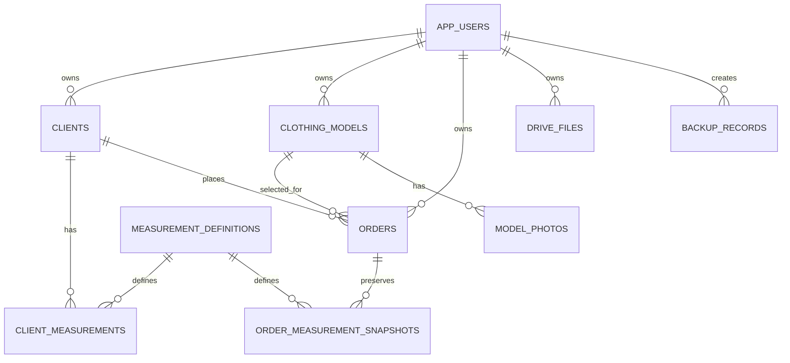

# Schéma de base de données — Sutura V2

> Schéma logique initial pour PostgreSQL + Entity Framework Core 10.  
> Les mensurations exactes et la politique de paiement restent à confirmer avec le couturier.

## 1. Principes

- PostgreSQL est la source principale des données métier.
- Les clés primaires sont des UUID (`uuid` / `Guid`).
- Chaque donnée métier appartient à un utilisateur (`user_id`).
- Les montants sont des `numeric(12,2)` ; la devise est explicitement enregistrée (par défaut à configurer, par exemple XOF).
- Les dates métier sont stockées en `timestamptz` ou `date` selon leur sens.
- Les photos ne sont pas stockées en `bytea` : elles sont dans Google Drive, avec une référence en base.
- Les suppressions doivent être prudentes : privilégier l'archivage ou `RESTRICT` pour les données historiques.

## 2. Diagramme relationnel simplifié

`APP_USERS` représente conceptuellement l'utilisateur Identity. En pratique, utiliser `AspNetUsers` généré par ASP.NET Core Identity, et référencer sa clé depuis les tables métier.

## 3. Tables

### 3.1 `AspNetUsers` (ASP.NET Core Identity)

Utiliser `IdentityUser<Guid>` ou une classe `ApplicationUser : IdentityUser<Guid>`.

Champs principaux hérités :
- `Id uuid` — PK
- `UserName`, `NormalizedUserName`
- `Email`, `NormalizedEmail`, `EmailConfirmed`
- `PasswordHash`
- `PhoneNumber`, `PhoneNumberConfirmed`
- `TwoFactorEnabled`, `LockoutEnd`, etc.

Ajouter uniquement les champs de profil réellement nécessaires (par exemple `DisplayName`). Ne pas dupliquer le mot de passe dans une table personnalisée.

### 3.2 `Clients`

| Colonne | Type | Règle |
|---|---|---|
| `id` | uuid | PK |
| `user_id` | uuid | FK `AspNetUsers`, NOT NULL |
| `first_name` | varchar(100) | NOT NULL |
| `last_name` | varchar(100) | nullable |
| `phone_number` | varchar(30) | NOT NULL |
| `notes` | text | nullable, notes utiles non sensibles |
| `created_at` | timestamptz | NOT NULL |
| `updated_at` | timestamptz | NOT NULL |
| `is_archived` | boolean | NOT NULL DEFAULT false |

Index : `(user_id, phone_number)`, `(user_id, last_name, first_name)`. Ne pas imposer l'unicité du téléphone sans décider comment gérer les numéros partagés.

### 3.3 `MeasurementDefinitions`

Catalogue des types de mensurations. Il permet de conserver une liste fixe, tout en évitant de coder chaque mesure en colonne.

| Colonne | Type | Règle |
|---|---|---|
| `id` | uuid | PK |
| `user_id` | uuid | nullable pour les définitions système |
| `code` | varchar(60) | NOT NULL |
| `label` | varchar(100) | NOT NULL |
| `unit` | varchar(10) | NOT NULL, par ex. `cm` |
| `display_order` | int | NOT NULL |
| `is_active` | boolean | NOT NULL DEFAULT true |

Index unique adapté : `(user_id, code)` avec traitement distinct des définitions système. Les définitions initiales exactes sont à valider avant le seed final.

### 3.4 `ClientMeasurements`

Valeurs courantes des mensurations d'un client.

| Colonne | Type | Règle |
|---|---|---|
| `id` | uuid | PK |
| `client_id` | uuid | FK `Clients`, NOT NULL |
| `measurement_definition_id` | uuid | FK `MeasurementDefinitions`, NOT NULL |
| `value` | numeric(8,2) | NOT NULL, supérieur à 0 |
| `measured_at` | timestamptz | NOT NULL |
| `notes` | varchar(300) | nullable |

Contrainte unique : `(client_id, measurement_definition_id)` si une seule valeur courante est conservée. Si l'historique complet est nécessaire, retirer cette unicité et ajouter une notion de version/date. Cette décision doit être prise avant les migrations définitives.

### 3.5 `ClothingModels`

Catalogue des modèles de vêtements proposés par le couturier.

| Colonne | Type | Règle |
|---|---|---|
| `id` | uuid | PK |
| `user_id` | uuid | FK `AspNetUsers`, NOT NULL |
| `name` | varchar(120) | NOT NULL |
| `description` | text | nullable |
| `category` | varchar(80) | nullable |
| `created_at` | timestamptz | NOT NULL |
| `updated_at` | timestamptz | NOT NULL |
| `is_archived` | boolean | NOT NULL DEFAULT false |

Un modèle peut posséder une ou plusieurs photos. Le besoin initial impose une photo principale ; le modèle `ModelPhotos` permet de l'étendre sans modifier `ClothingModels`.

### 3.6 `ModelPhotos`

| Colonne | Type | Règle |
|---|---|---|
| `id` | uuid | PK |
| `clothing_model_id` | uuid | FK `ClothingModels`, NOT NULL |
| `drive_file_id` | varchar(200) | NOT NULL |
| `file_name` | varchar(255) | NOT NULL |
| `mime_type` | varchar(100) | NOT NULL |
| `size_bytes` | bigint | NOT NULL |
| `is_primary` | boolean | NOT NULL DEFAULT false |
| `created_at` | timestamptz | NOT NULL |

Règle métier : au plus une photo principale par modèle. La faire respecter par la logique applicative et, si possible, par un index unique partiel PostgreSQL. L'identifiant Drive est stocké, pas une URL publique.

### 3.7 `Orders`

| Colonne | Type | Règle |
|---|---|---|
| `id` | uuid | PK |
| `user_id` | uuid | FK `AspNetUsers`, NOT NULL |
| `client_id` | uuid | FK `Clients`, NOT NULL |
| `clothing_model_id` | uuid | FK `ClothingModels`, nullable si modèle libre autorisé |
| `order_number` | varchar(40) | NOT NULL |
| `description` | text | nullable |
| `price` | numeric(12,2) | NOT NULL, >= 0 |
| `currency` | char(3) | NOT NULL |
| `delivery_date` | date | NOT NULL |
| `status` | varchar(30) | NOT NULL |
| `created_at` | timestamptz | NOT NULL |
| `updated_at` | timestamptz | NOT NULL |
| `completed_at` | timestamptz | nullable |

Index unique : `(user_id, order_number)`. Vérifier que `client_id` et `clothing_model_id` appartiennent au même `user_id` que la commande.

Statuts initiaux proposés : `Pending`, `InProgress`, `Ready`, `Delivered`, `Cancelled`. Les transitions autorisées doivent être contrôlées dans le domaine.

### 3.8 `OrderMeasurementSnapshots`

Copie des mensurations utilisées pour une commande. Elle évite qu'une modification ultérieure de la fiche client change rétroactivement les mesures d'une ancienne commande.

| Colonne | Type | Règle |
|---|---|---|
| `id` | uuid | PK |
| `order_id` | uuid | FK `Orders`, NOT NULL |
| `measurement_definition_id` | uuid | FK `MeasurementDefinitions`, NOT NULL |
| `label_snapshot` | varchar(100) | NOT NULL |
| `value` | numeric(8,2) | NOT NULL |
| `unit` | varchar(10) | NOT NULL |

Contrainte unique : `(order_id, measurement_definition_id)`.

### 3.9 `DriveFiles`

Registre technique des fichiers gérés dans Google Drive.

| Colonne | Type | Règle |
|---|---|---|
| `id` | uuid | PK |
| `user_id` | uuid | FK `AspNetUsers`, NOT NULL |
| `drive_file_id` | varchar(200) | NOT NULL |
| `purpose` | varchar(30) | `ModelPhoto`, `DatabaseBackup`, etc. |
| `file_name` | varchar(255) | NOT NULL |
| `mime_type` | varchar(100) | NOT NULL |
| `size_bytes` | bigint | nullable |
| `created_at` | timestamptz | NOT NULL |
| `deleted_at` | timestamptz | nullable |

Index unique : `(user_id, drive_file_id)`.

### 3.10 `BackupRecords`

Historique des sauvegardes.

| Colonne | Type | Règle |
|---|---|---|
| `id` | uuid | PK |
| `user_id` | uuid | FK `AspNetUsers`, NOT NULL |
| `drive_file_id` | varchar(200) | NOT NULL |
| `file_name` | varchar(255) | NOT NULL |
| `database_version` | varchar(50) | nullable |
| `created_at` | timestamptz | NOT NULL |
| `size_bytes` | bigint | nullable |
| `status` | varchar(20) | `Pending`, `Completed`, `Failed` |
| `checksum_sha256` | varchar(64) | nullable |
| `error_message` | text | nullable |

Ne pas enregistrer de secrets OAuth dans cette table.

## 4. Relations et règles métier

- Un utilisateur possède plusieurs clients, modèles et commandes.
- Un client peut avoir plusieurs commandes.
- Un modèle peut être sélectionné sur plusieurs commandes.
- Une commande conserve un instantané de ses mensurations.
- Une commande doit référencer un client appartenant au même utilisateur.
- Une commande ne peut pas être marquée `Delivered` avant d'être `Ready` (règle proposée).
- Une commande livrée ou annulée ne doit pas être supprimée physiquement.
- Une photo principale maximum par modèle.
- Les montants doivent être positifs ou nuls, avec devise explicite.

## 5. Paiements : décision en attente

Le fonctionnement des paiements n'a pas encore été confirmé. Ne pas imposer un acompte, un paiement partiel ou un mode de règlement sans validation métier.

Si le couturier confirme le suivi des règlements, ajouter une table `Payments` :
- `id`, `order_id`, `amount`, `currency`, `paid_at`, `method`, `reference`, `notes`, `created_at`.
- Une commande peut avoir plusieurs paiements.
- Le montant payé est calculé par somme des paiements valides ; le reste à payer = prix - montant payé.
- Ajouter une règle empêchant les paiements cumulés supérieurs au prix, sauf décision explicite.

## 6. Migrations et conventions EF Core

- Créer `SuturaDbContext` dans Infrastructure.
- Configurer les relations, index, contraintes et précisions numériques dans `IEntityTypeConfiguration<T>`.
- Les migrations sont versionnées dans `Infrastructure/Persistence/Migrations`.
- Ne pas modifier une migration déjà appliquée en environnement partagé : créer une nouvelle migration.
- Utiliser des données seed uniquement pour les définitions de mensurations réellement validées.
- Vérifier les migrations sur une base de développement vide avant de continuer.
